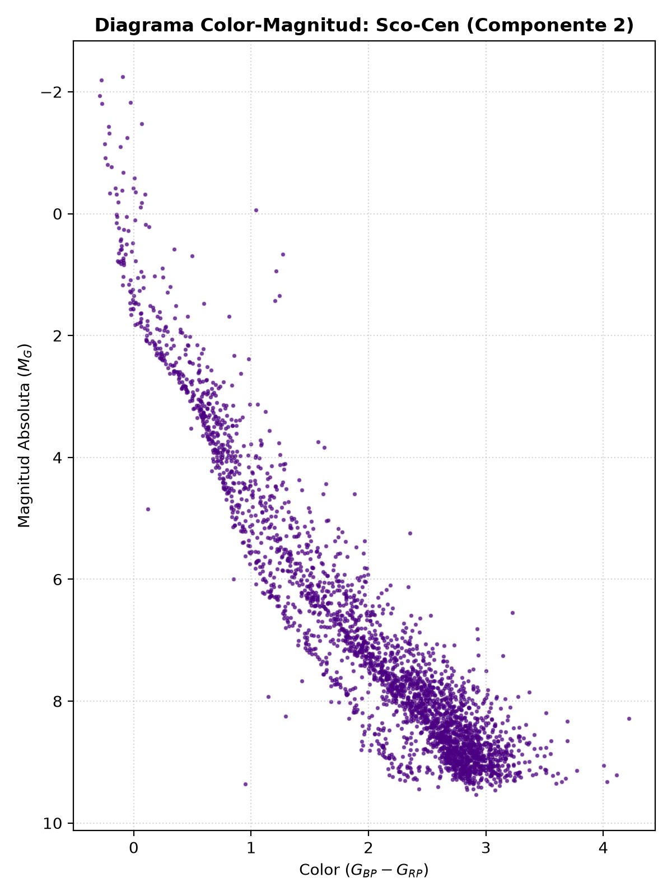
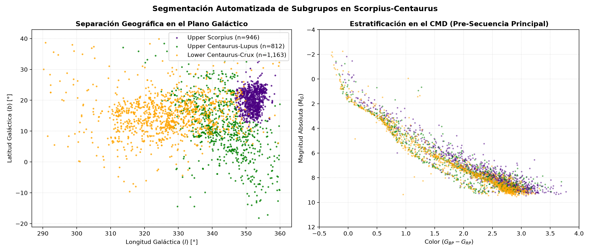

# Project: Scorpius-Centaurus Unsupervised Clustering & Kinematics

## Description

The characterization of dynamic structures in our galaxy represents a major challenge for modern astronomy, especially when seeking to understand local star formation. The Scorpius-Centaurus (Sco-Cen) association stands out as the closest OB-type young stellar association to the Sun. Its proximity makes it an ideal laboratory for studying stellar evolution; however, its vast extent across the sky makes it difficult to precisely distinguish genuine members from field stars.

Leveraging the astrometric precision of the Gaia DR3 catalog, this project implements an automated workflow based on Gaussian Mixture Models (GMM). The objective is to process spatial and kinematic multidimensionality to probabilistically identify Sco-Cen's subgroups, isolating the core of the association from the galactic background through kinematic coherence in phase space.

## Project Structure

*   **`pipeline.sh`**: Orchestrates and automates the sequential execution of the entire workflow (this is the only script required to reproduce the results).
*   **`1_adquisicion_adql.py`**: Uses `astroquery.gaia` to execute remote ADQL queries and download the bounded astrometric components.
*   **`2_preprocesamiento.py`**: Employs `pandas` and `numpy` to clean incomplete records and apply Z-score standardization to the kinematic variables.
*   **`3_clustering_gmm.py`**: Uses `sklearn.mixture` to train the main Gaussian Mixture Model, evaluating the optimal number of components with the Bayesian Information Criterion (BIC).
*   **`4_subgrupos_arbol.py`**: Applies a second 3D GMM to segment the three historical subgroups and generates visualizations using `astropy`.

## Data Used

Data was extracted from the Gaia DR3 mission by spatially bounding the region using galactic coordinates ($l, b$). To ensure the viability of the statistical model and capture the true three-dimensional structure, rigorous filters were applied via ADQL:
*   **Magnitude Limit:** Stars with a G-band magnitude brighter than 15, ensuring highly reliable astrometry and optimizing computation time.
*   **Parallax Filter:** Restriction between $5 \le \varpi \le 12\text{ mas}$, placing the sample at an average distance of 80 to 200 parsecs (consistent with literature to discard distant background giants).
*   **Relative Precision:** A relative parallax error of less than 10% was required ($\varpi/\sigma_{\varpi} > 10$).

The variables introduced to the Machine Learning model were the equatorial proper motions ($\mu_{\alpha}^*, \mu_{\delta}$) and parallax ($\varpi$), which were previously standardized to avoid algorithmic biases.

## Results

## Results Analysis and Physical Characterization

### Kinematic Identification via GMM
Stars originating from the same molecular cloud conserve similar velocity vectors over time. When projecting equatorial proper motions, Sco-Cen members manifest as a clear overdensity against the erratic behavior of the stellar background.

To automatically identify this structure, a parametric sweep was performed by varying the GMM components ($k$) from 1 to 8. Using the **Bayesian Information Criterion (BIC)**, the global minimum was found at 9 components, successfully describing the entire population without overfitting. From this, membership probabilities (`predict_proba`) were assigned to each star, mathematically filtering out the noise.

### Spatial Morphology and Color-Magnitude Diagram (CMD)
The success of the GMM was validated by cross-referencing the obtained information with photometric parameters (magnitudes and colors). The empirical Hertzsprung-Russell diagram revealed clear stratification and broadening in the Pre-Main Sequence (PMS). To isolate these populations, a second spatial GMM with $k=3$ was trained evaluating galactic longitude ($l$), latitude ($b$), and parallax ($\varpi$):

*   **Upper Scorpius (Indigo):** Overdensity at $l \in [345^\circ, 360^\circ]$. In the CMD, it is positioned in the upper, most luminous envelope of the PMS, confirming its extreme dynamic youth (~5–10 Myr) with still-inflated stellar radii.
*   **Upper Centaurus-Lupus (Green):** The central and densest component ($l \in [305^\circ, 345^\circ]$). It perfectly occupies the intermediate stratum of the PMS, validating its intermediate evolutionary age (~16 Myr).
*   **Lower Centaurus-Crux (Orange):** Dominates the lowest galactic longitudes. It couples to the lower base of the sequence in the CMD, delineating stars with the longest thermal contraction time (~17-20 Myr) and closest geometric proximity.

## Conclusions

The implementation of data mining and Machine Learning proved indispensable for handling a volume of over 72,000 Gaia stars. The GMM algorithm, optimized through the BIC criterion, successfully cleaned the Milky Way background noise and isolated the Scorpius-Centaurus association in multidimensional phase space.

It is particularly remarkable that when constructing the Color-Magnitude Diagram (CMD) with the filtered sample, the stars formed a coherent Pre-Main Sequence line. This demonstrates the model's robustness: it was able to reconstruct the evolutionary state and age differences of the stars based exclusively on their kinematics and 3D positions, without having processed any brightness or color data during its training.

Finally, the parametric identification of the three subgroups (Upper Scorpius, Upper Centaurus-Lupus, and Lower Centaurus-Crux) fully coincides with the physical models described in historical and contemporary literature. This project proves that automated clustering algorithms are high-precision tools capable of ordering space, paving the way for mapping complex clusters in our galaxy without relying on manual selections.
